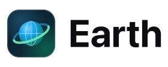
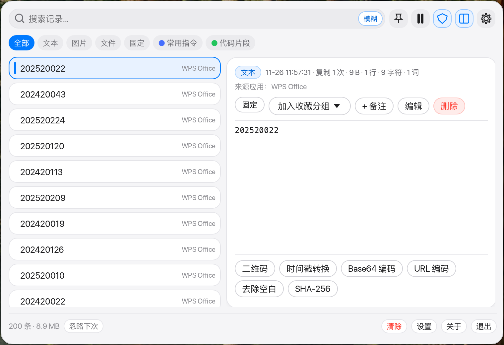
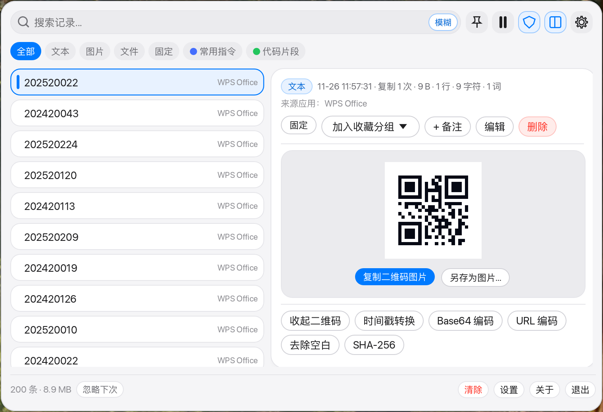
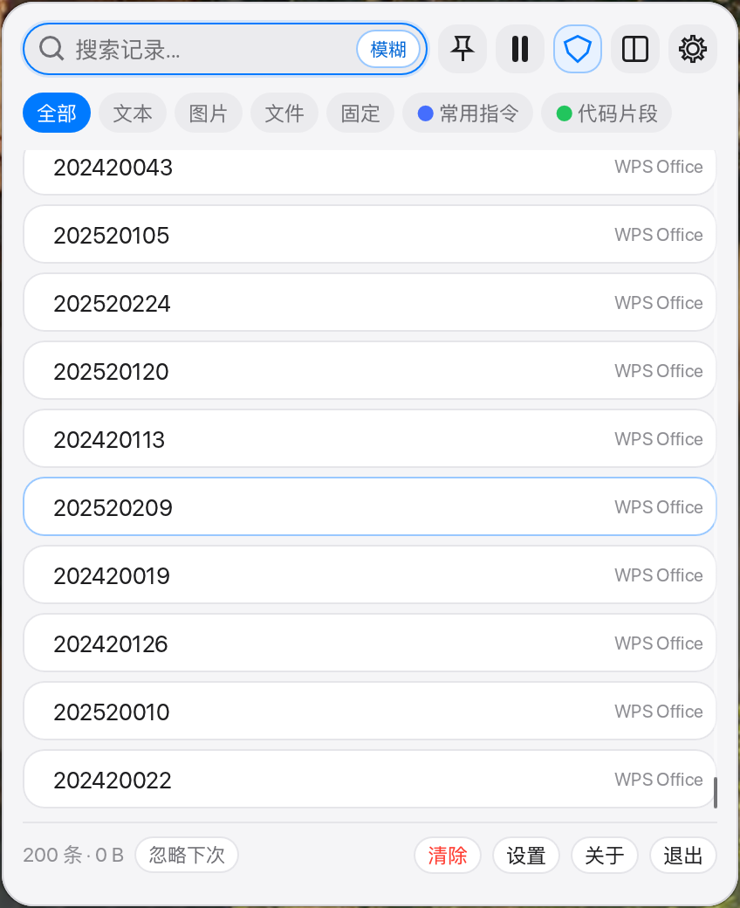
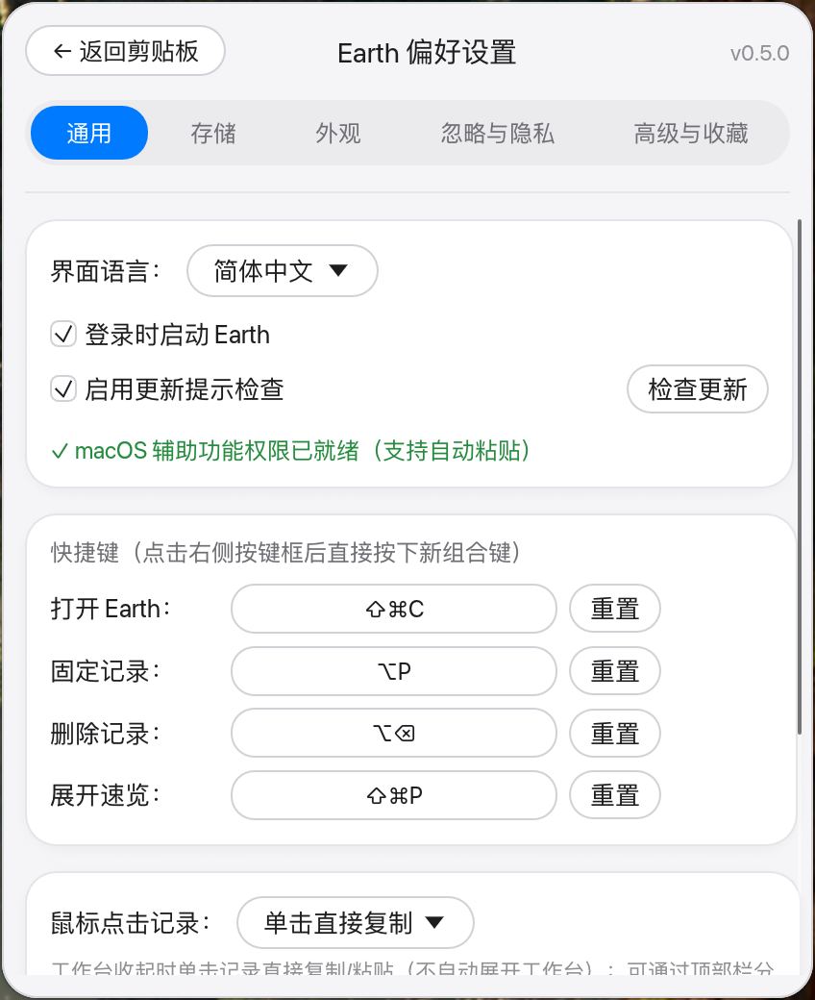
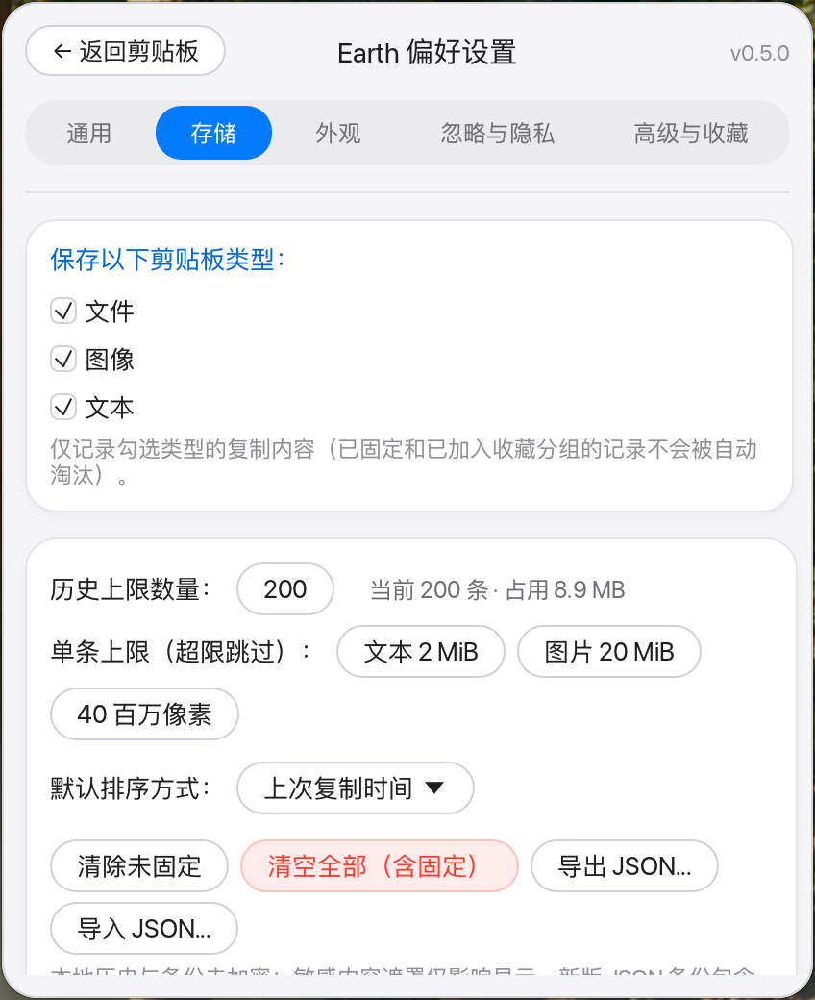
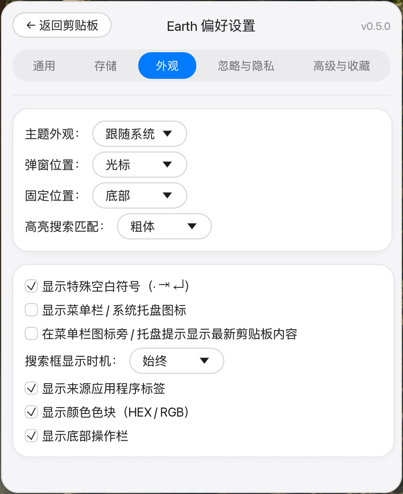
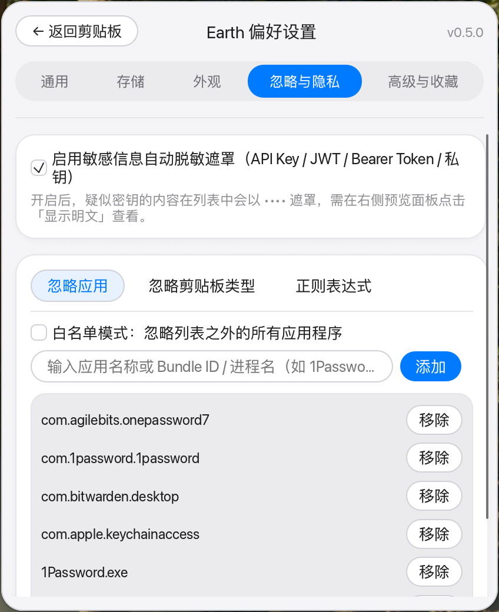
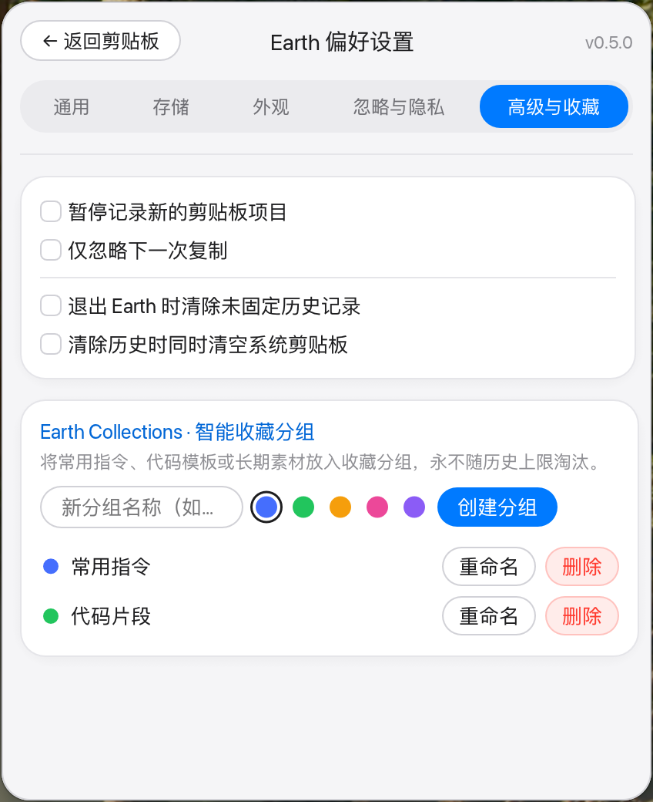

<p align="center">
  <picture>
    <source media="(prefers-color-scheme: dark)" srcset="assets/earth-wordmark-dark.svg">
    
  </picture>
</p>

<p align="center">
  An ultra-fast clipboard manager &amp; quick-preview workbench, built in pure Rust.
</p>

<p align="center">
  English · <a href="README.zh-CN.md">简体中文</a>
</p>

<p align="center">
  <a href="https://github.com/lumingbao/Earth/releases/latest"><b>Download</b></a>
  &nbsp;·&nbsp;
  <a href="#screenshots">Screenshots</a>
  &nbsp;·&nbsp;
  <a href="#features">Features</a>
  &nbsp;·&nbsp;
  <a href="#shortcuts">Shortcuts</a>
  &nbsp;·&nbsp;
  <a href="#build--release">Build</a>
  &nbsp;·&nbsp;
  <a href="#community">Community</a>
</p>

Earth brings a keyboard-first clipboard history and a split-pane quick-preview
workbench to a lightweight native app with a pure Rust core (`eframe / egui` +
`clipboard-rs` + `rusqlite`).

Text, rich text, images, files, inline editing, notes, offline QR codes, Quick
Actions, smart collections, sensitive-data masking, and English / Chinese UI.
Builds for **macOS** and **Windows** — no Electron, no Chromium, no WebView.

## Screenshots

<table>
  <tr>
    <td align="center" width="50%">
      <br>
      <sub><b>Quick-Preview Workbench</b> · Inspect, edit, pin, tag &amp; run Quick Actions</sub>
    </td>
    <td align="center" width="50%">
      <br>
      <sub><b>Offline QR Code</b> · Generate, copy, or save QR images locally</sub>
    </td>
  </tr>
</table>

<table>
  <tr>
    <td align="center" width="33%">
      <br>
      <sub><b>Compact Launcher</b> · Instant fuzzy search &amp; filter capsules</sub>
    </td>
    <td align="center" width="33%">
      <br>
      <sub><b>General</b> · Language, updates, live shortcut recorder &amp; click mode</sub>
    </td>
    <td align="center" width="33%">
      <br>
      <sub><b>Storage</b> · Capture types, limits, sorting &amp; JSON backups</sub>
    </td>
  </tr>
  <tr>
    <td align="center" width="33%">
      <br>
      <sub><b>Appearance</b> · System / Dark / Light theme, positioning &amp; badges</sub>
    </td>
    <td align="center" width="33%">
      <br>
      <sub><b>Ignore &amp; Privacy</b> · Secret masking, app rules &amp; regex filters</sub>
    </td>
    <td align="center" width="33%">
      <br>
      <sub><b>Advanced &amp; Collections</b> · Pause controls &amp; color-coded groups</sub>
    </td>
  </tr>
</table>

## Lightweight by Design

| Metric | Earth |
| --- | --- |
| Runtime | Pure Rust native binary + GPU rendering (no Electron / WebView) |
| Footprint | ~**18 MB** single-arch release binary / ~**18 MB** universal macOS `.dmg` |
| List rendering | Viewport-virtualized `34 px` rows with per-item preview & thumbnail caches |
| Clipboard listener | Native change notifications on Windows; 100 ms pasteboard change-count poll on macOS |
| Persistence | Local SQLite (WAL mode) with content-hash dedup and separated image / thumbnail storage |

## Features

- **Multi-type history & smart search**: Captures plain/rich text (HTML/RTF), PNG images with instant thumbnails, and files/folders. Filter by `All`, `Text`, `Images`, `Files`, `Pinned`, or color-coded **Earth Collections** (pinned & collected items are never evicted). Search with **Exact**, **Fuzzy (`nucleo`)**, or **Regex** across content, paths, and notes.
- **Split-pane Quick-Preview Workbench**:
  - **Inline editing & notes**: Edit any text entry in place (**Save** or **Save & Paste**) and attach searchable notes.
  - **Offline QR codes**: Generate crisp local QR codes from text or links, then **Copy QR Image** or **Save Image As...**.
  - **Images, files & colors**: Toggle **Fit Window / Crisp Preview (up to 2048 px)** with background decoding, verify and reveal files in Finder / Explorer, and copy HEX / RGB color swatches in one click.
- **Quick Actions (offline transforms)**: `Format / Minify JSON`, `Base64`, `URL Encode / Decode`, `Unix Timestamp ↔ Local/UTC`, `snake_case` / `camelCase` / `UPPER_CASE`, `Deduplicate / Sort Lines`, `Unescape`, `Trim Whitespace`, and `SHA-256`.
- **Flexible click & paste workflow**: Switch between **Double-Click to Copy (Single-Click Previews)** and **Single-Click to Copy Directly** in **Preferences › General**.
- **Privacy & masking**: Auto-detects secrets (Private Keys, JWTs, API Keys, Bearer Tokens) and masks them as `••••` until revealed. Supports app blocklist/allowlist, clipboard type/format ignores (`ConcealedType`, `TransientType`, `ExcludeClipboardContentFromMonitorProcessing`), regex ignores, **Pause Recording**, and **Ignore Next Copy**.
- **Multi-language UI (i18n)**: Ships with **English** and **简体中文**. Defaults to **Follow System** and switches live in **Preferences › General › Language** (updating both the UI and menu bar / system tray).
- **Backup & verified updates**: Export/import portable JSON backups (with embedded PNGs and deduplication). Official signed builds verify `SHA256SUMS.txt`, code signatures, publisher identity, and macOS Apple notarization before offering **Restart to Update**; unsigned builds keep the manual **Download** button.

## Shortcuts

All shortcuts can be customized live in **Preferences › General** (disabled while typing in search or inline editors so text editing and IME stay intact).

| Action | macOS | Windows |
| --- | --- | --- |
| Open / hide Earth | `⇧⌘C` | `Shift+Alt+V` |
| Instant paste top 1–9 | `⌘1`–`⌘9` | `Alt+1`–`Alt+9` |
| Copy only | `⌥+Enter` | `Alt+Enter` |
| Paste as plain text | `⇧⌘+Enter` | `Ctrl+Shift+Enter` |
| Toggle Quick-Preview Workbench | `⇧⌘P` | `Ctrl+Shift+P` |
| Pin / unpin item | `⌥P` | `Alt+P` |
| Delete item | `⌥⌫` | `Alt+Delete` |
| Cycle filter capsules | `Tab` / `Shift+Tab` | `Tab` / `Shift+Tab` |

## Build & Release

Requires Rust `1.95+` (Edition `2024`; verified on Rust `1.100.0`):

```bash
cargo run                      # Run debug build
cargo test                     # Run unit tests
node packaging/semver.test.js  # Verify installer SemVer anti-downgrade logic
cargo build --release          # Build release binary
./scripts/package-macos.sh     # Package macOS dev build (Earth.app, DMG, PKG -> dist/)
```

<details>
<summary>Platform notes, storage limits, and release signing configuration</summary>

### Platform Notes

- **macOS**: Runs as a menu-bar accessory app (`LSUIElement=true`). Run `./scripts/package-macos.sh universal` for a universal (`arm64` + `x86_64`) bundle, DMG, and PKG, or `native` for host-only. For **Auto-Paste on Selection**, grant **System Settings › Privacy & Security › Accessibility** (after a re-signed upgrade, remove Earth with `-` and re-add if macOS still reports unauthorized).
- **Windows**: Uses `windows-sys` for DPI-aware positioning, system tray menu, `SendInput` (`Ctrl+V`) auto-paste, and login autostart. Package locally with `scripts/package-windows.ps1`. Both macOS PKG and Windows Setup enforce full SemVer anti-downgrade checks.

### Storage & Capture Limits

Defaults to 2 MiB text (including HTML/RTF), 20 MiB image, and 40 megapixels per capture (configurable in **Preferences › Storage**). Oversized images or text are skipped; oversized rich text falls back to plain text when available. History and JSON backups store clipboard content unencrypted — keep backups only in trusted locations.

### CI Artifacts & Official Signing

- **Unsigned CI builds**: Trigger **Actions › Build & Release (Windows + macOS) › Run workflow** with `publish_release` unchecked to download `earth-windows-x64-development` or `earth-macos-universal-development` from **Artifacts**.
- **Tagged releases**: Push a tag strictly matching `v{Cargo.toml version}`. When signing credentials are absent, each platform publishes unsigned installers + `SHA256SUMS.txt` (in-app updates stay in manual **Download** mode). When full credentials are present, builds run in `official` mode with signing, Apple notarization, and trusted-publisher checks (partial credentials fail fast).

| Platform | Repository Variables | Repository Secrets |
| --- | --- | --- |
| macOS | `EARTH_UPDATE_MACOS_TEAM_ID`, `EARTH_MACOS_SIGN_IDENTITY`, `EARTH_MACOS_INSTALLER_IDENTITY` | `EARTH_MACOS_APP_P12_BASE64`, `EARTH_MACOS_INSTALLER_P12_BASE64`, `EARTH_MACOS_P12_PASSWORD`, `EARTH_APPLE_ID`, `EARTH_APPLE_APP_PASSWORD` |
| Windows | `EARTH_UPDATE_WINDOWS_CERT_SHA256` | `EARTH_WINDOWS_PFX_BASE64`, `EARTH_WINDOWS_PFX_PASSWORD` |

Local official packaging additionally uses `EARTH_NOTARY_PROFILE` (macOS `notarytool` keychain profile) or `EARTH_WINDOWS_SIGN_THUMBPRINT` + Windows SDK `signtool` (Windows).

</details>

## Community

- [GitHub Issues](https://github.com/lumingbao/Earth/issues) — bug reports, feature requests, and discussions.
- WeChat (Author: 西岚 / Xilan) — scan to connect or share feedback:

  

- Contributing & Security: see [CONTRIBUTING.md](CONTRIBUTING.md) and [SECURITY.md](SECURITY.md).

## License

[MIT](LICENSE).

<sub>Built end-to-end through Vibe Coding — architecture, cross-platform Rust implementation, UI polish, and interaction details iterated with AI.</sub>
